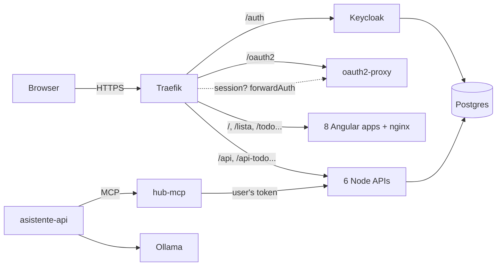

# Hub de casa (Home Hub)

[Español](README.md) · **English**

A set of web apps to organise everyday life at home — shopping list,
tasks, calendar, expenses and weekly meal plan — meant to be used alone or
in a group (partner, family, flatmates...). Everything lives under a single
domain, with one user account, the same design across all apps and an
assistant you can just tell what you need.

This repository is meant for **anyone to run at home**: here you have the
code, how to build the images and how to deploy it with **Docker Compose**
or on **Kubernetes**, including login with Keycloak and the assistant with
its MCP server.

> The apps' user interface is in **Spanish**. Folder names, routes and some
> settings are in Spanish too; this guide translates them where needed.

- [What's included](#whats-included)
- [How it's built](#how-its-built)
- [Building the images](#building-the-images)
- [Deploying with Docker Compose](#deploying-with-docker-compose)
- [Deploying on Kubernetes](#deploying-on-kubernetes)
- [Keycloak and login](#keycloak-and-login)
- [Assistant and MCP](#assistant-and-mcp)
- [Optional: push notifications, Google Calendar, prices, legal pages](#optional)
- [Backups and updates](#backups-and-updates)
- [Troubleshooting](#troubleshooting)
- [License](#license)

---

## What's included

| App | Path | What it's for |
|---|---|---|
| Inicio (Home) | `/` | Landing page: «Hoy» (Today) summary with what matters from the other apps, and push notification opt-in |
| Lista de la compra (Shopping list) | `/lista` | Collaborative list with automatic categories, custom sections (shops, «for mum»...), pinned items and price comparison |
| Tareas (Tasks) | `/todo` | Personal or group tasks, as a list or kanban board, with due date, importance and recurrence |
| Calendario (Calendar) | `/calendario` | Notes and events per day, with time, reminder and recurrence; optionally with your Google Calendar |
| Gastos (Expenses) | `/gastos` | Personal or shared expenses, budget per category and who owes whom |
| Menú (Meal plan) | `/menu` | Lunches and dinners for the week; sends the ingredients to the shopping list |
| Perfil / Grupos (Profile / Groups) | `/perfil`, `/grupos` | Your account, friends, groups, recent activity, download or delete your data |

Anything personal is visible only to you; anything in a group, only to its
members. The apps are PWAs: they can be installed on a phone and keep
showing the last loaded data while offline.

## How it's built



| Folder | What it is |
|---|---|
| `inicio`, `lista-compra`, `todo`, `calendario`, `gastos`, `menu`, `perfil`, `grupos` | Angular apps (each with its own `Dockerfile`: builds and serves with nginx) |
| `lista-compra-api` | Profile, friends, groups, invites, lists, push notifications and price comparison |
| `todo-api`, `calendario-api`, `gastos-api`, `menu-api` | One API per app (Express + Postgres + WebSocket) |
| `asistente-api` | Assistant chat (Ollama + hub-mcp tools) |
| `hub-mcp` | MCP server: the apps as tools for a language model |
| `deploy/` | Traefik (Compose), Keycloak (realm), Postgres (database script), Kubernetes (kustomize) |
| `scripts/` | `build-images.sh` and `generar-secretos.sh` (generate secrets) |

How login works, in one sentence: **Traefik asks oauth2-proxy whether
each request has a session**; if it doesn't, oauth2-proxy sends you to the
Keycloak login; if it does, Traefik lets the request through and adds your
Keycloak token (`X-Auth-Request-Access-Token`), which each API verifies
again on its own against the realm's public keys. The APIs have no users or
passwords of their own: the user is the token's `sub`.

Public paths (no login): `/auth` (Keycloak), `/oauth2` (the login flow
itself), `/legal/` and `/robots.txt`. Everything else requires a session.

## Building the images

There are no published images: you build them from this repository. There
are 15 (8 web apps + 7 Node services) and each folder has a self-contained
`Dockerfile` (the Angular apps are compiled inside Docker, you don't need
Node installed).

Requirements: Docker 24+ (with BuildKit). On a Raspberry Pi 5 the first
build takes about half an hour; on a regular PC, much less.

```bash
# All of them, as local images compra-hub/<app>:latest
sh scripts/build-images.sh

# Only some
sh scripts/build-images.sh lista-compra todo-api

# With your registry and a tag, pushing them
REGISTRY=registry.yourdomain.com/hub TAG=1.0.0 PUSH=1 sh scripts/build-images.sh

# Multi-arch (e.g. build on an x86 PC for an ARM cluster)
PLATFORMS=linux/amd64,linux/arm64 REGISTRY=registry.yourdomain.com/hub TAG=1.0.0 sh scripts/build-images.sh
```

If you'd rather do it by hand, it's one `docker build` per folder:

```bash
docker build -t compra-hub/lista-compra:latest lista-compra
docker build -t compra-hub/lista-compra-api:latest lista-compra-api
# ...
```

Full list: `inicio lista-compra todo calendario gastos menu perfil grupos
lista-compra-api todo-api calendario-api gastos-api menu-api
asistente-api hub-mcp`.

## Deploying with Docker Compose

Runs everything on a single machine: Traefik (HTTPS with Let's Encrypt),
Postgres, Keycloak, oauth2-proxy, the 7 APIs and the 8 apps. At idle it
uses around 1 GB of RAM (Keycloak about 600 MB).

### 1. Requirements

- Docker with the `docker compose` plugin, and `openssl`.
- A domain (or subdomain) pointing to the machine, with ports 80 and 443
  reachable so Let's Encrypt can issue the certificate. If you only want to
  try it locally, see [Trying it locally](#trying-it-locally-no-domain).

### 2. Configuration

```bash
git clone <this repository> hub && cd hub
sh scripts/generar-secretos.sh     # creates .env from .env.example and fills in passwords and keys
```

Open `.env` and check at least:

| Variable | What to set |
|---|---|
| `HUB_DOMAIN` | Your domain, e.g. `home.yourdomain.com` (without `https://`) |
| `ACME_EMAIL` | Your email for Let's Encrypt (optional, recommended) |
| `VAPID_SUBJECT` | `mailto:` with your email (required by the web push standard) |
| `OLLAMA_URL`, `OLLAMA_MODEL` | Where your Ollama is, if you want the assistant (see [Assistant and MCP](#assistant-and-mcp)) |

`generar-secretos.sh` only fills in empty values, so it's safe to run it
again. `.env` is in `.gitignore`; don't upload it anywhere.

### 3. Build and start

```bash
sh scripts/build-images.sh
docker compose up -d
docker compose ps        # wait until keycloak shows "healthy" (1-2 minutes)
```

On first start, Postgres creates one database and user per service
(`deploy/postgres/init-multi-db.sh`) and Keycloak imports the `compras`
realm (`deploy/keycloak/realm-compras.json`) with the domain and client
secret from your `.env`.

### 4. First login

1. Open `https://<HUB_DOMAIN>`: you'll be taken to the Keycloak login.
2. Click **Regístrate** (Register) and create your account. You're in.
3. Go through [Keycloak and login](#keycloak-and-login) to enable account
   deletion, decide whether to keep registration open and set up email.

The Keycloak admin console is at `https://<HUB_DOMAIN>/auth/admin/` (user
`admin`, password `KEYCLOAK_ADMIN_PASSWORD` from your `.env`).

### Trying it locally (no domain)

```bash
# in .env
HUB_DOMAIN=hub.localhost
TLS_CERT_RESOLVER=
```

`*.localhost` points to your own computer in modern browsers. With
`TLS_CERT_RESOLVER` empty, Traefik uses a self-signed certificate: the
browser will warn you the first time and you'll have to accept it (for
`/auth` too). Push notifications don't work with self-signed certificates.

### Behind another proxy

If you already have a reverse proxy on the machine (Nginx Proxy Manager,
Caddy, a tunnel...), change `HTTP_PORT`/`HTTPS_PORT` in `.env`, leave
`TLS_CERT_RESOLVER` empty and forward your domain's HTTPS traffic to
Traefik's port. Traefik must still receive the original domain (`Host`
header), because routing depends on it.

## Deploying on Kubernetes

The manifests are in `deploy/` as a **kustomize** project
(`kubectl apply -k`), in the `compra-hub` namespace. They include Postgres,
Keycloak, oauth2-proxy, the APIs, the apps and the Ingresses.

### 1. Requirements

- **Traefik** as Ingress controller (k3s's default): login uses its
  Middlewares (`forwardAuth` and `stripPrefix`). With another controller
  you'd have to translate `deploy/k8s/ingress.yaml` (in ingress-nginx:
  `auth-url`, `auth-signin` and `auth-response-headers`).
- A default StorageClass for the Postgres volume (5 GiB).
- Optional: **cert-manager** with a `letsencrypt-prod` ClusterIssuer for
  the certificate (if your issuer has another name, change the annotation
  in `deploy/k8s/ingress*.yaml`; if you don't use cert-manager, remove it).

### 2. Getting the images into the cluster

Build the images ([Building the images](#building-the-images)) and pick
one option:

- **With a registry** (any cluster):

  ```bash
  REGISTRY=registry.yourdomain.com/hub TAG=1.0.0 PUSH=1 sh scripts/build-images.sh
  cd deploy
  for app in inicio lista-compra todo calendario gastos menu perfil grupos \
             lista-compra-api todo-api calendario-api gastos-api menu-api asistente-api hub-mcp; do
    kustomize edit set image compra-hub/$app=registry.yourdomain.com/hub/$app:1.0.0
  done
  cd ..
  ```

  (without the `kustomize` binary, edit the `images:` block in
  `deploy/kustomization.yaml` by hand). If the registry is private, create
  a `docker-registry` Secret in the namespace and add it as
  `imagePullSecrets`.

- **Single-node k3s, no registry**: import the local images into
  containerd (the manifests use `imagePullPolicy: IfNotPresent`):

  ```bash
  for app in inicio lista-compra todo calendario gastos menu perfil grupos \
             lista-compra-api todo-api calendario-api gastos-api menu-api asistente-api hub-mcp; do
    docker save compra-hub/$app:latest | sudo k3s ctr images import -
  done
  ```

### 3. Configuration

```bash
sh scripts/generar-secretos.sh k8s   # creates deploy/k8s/secrets.env (not committed to git)
```

Edit `deploy/k8s/config.env`:

| Variable | What to set |
|---|---|
| `HUB_DOMAIN` | Your domain. kustomize copies it into the Ingresses |
| `OIDC_ISSUER` | `https://<HUB_DOMAIN>/auth/realms/compras` with the bundled Keycloak |
| `OIDC_JWKS_URI` | Leave as is with the bundled Keycloak (internal URL) |
| `OLLAMA_URL`, `OLLAMA_MODEL` | Your Ollama, if you want the assistant |
| `VAPID_SUBJECT` | `mailto:` with your email |

### 4. Deploy

```bash
kubectl apply -k deploy/
kubectl -n compra-hub get pods -w      # Keycloak takes 1-2 minutes to become Ready
```

Open `https://<HUB_DOMAIN>` and register as with Docker.

Configuration changes: edit `config.env` or `secrets.env` and run
`kubectl apply -k deploy/` again (kustomize generates ConfigMaps/Secrets
with a new suffix and the pods restart on their own).

### If oauth2-proxy can't reach Keycloak

oauth2-proxy discovers Keycloak through the **public** URL
(`OIDC_ISSUER`). If, from inside the cluster, your domain resolves to your
router's public IP and the router doesn't do *NAT loopback*, login will
fail with *discovery* errors in the oauth2-proxy logs. Fix: add a
`hostAliases` entry in `deploy/k8s/oauth2-proxy.yaml` with the internal IP
of Traefik's Service (`kubectl -n kube-system get svc traefik`); there's a
commented example in the file.

## Keycloak and login

### What's created automatically

`deploy/keycloak/realm-compras.json` is imported the first time Keycloak
starts (if the realm already exists, it's left untouched) and creates:

- The **`compras`** realm, in Spanish (English also available on the login
  page), with open registration, "remember me", password reset and brute
  force protection.
- 24-hour sessions (`ssoSessionIdleTimeout`/`ssoSessionMaxLifespan`),
  matching the oauth2-proxy cookie (`--cookie-expire=24h`), and 5-minute
  access tokens (oauth2-proxy refreshes them every 2, `--cookie-refresh`).
- The confidential client **`compras`** (used by oauth2-proxy), with:
  - redirect URIs `https://<domain>/oauth2/callback` and
    `https://<domain>/legal/*` (the second one is used by "delete my
    account");
  - post logout redirect URI `https://<domain>/*`;
  - the `OAUTH2_PROXY_CLIENT_SECRET` secret;
  - an *audience mapper* adding `compras` to the tokens (the APIs accept
    the `compras` and `account` audiences, variable `OIDC_AUDIENCES`).

> The client must be named `compras`: oauth2-proxy (`--client-id`) and the
> profile page (account deletion) rely on it.

### Recommended manual steps

In the console (`https://<domain>/auth/admin/`, realm **compras**):

1. **Let people delete their own account** from Perfil → Privacidad
   (Profile → Privacy; it deletes their hub data and then their Keycloak
   user):
   - *Authentication → Required actions*: enable **Delete Account**.
   - *Realm settings → User registration → Default roles*: **Assign role**
     → filter by clients → `account` **delete-account**.

   Or from the command line (Docker; on Kubernetes, the same with
   `kubectl -n compra-hub exec deploy/keycloak --`):

   ```bash
   docker compose exec keycloak bash -c '
     K=/opt/keycloak/bin/kcadm.sh
     $K config credentials --server http://localhost:8080/auth --realm master --user admin --password "$KC_BOOTSTRAP_ADMIN_PASSWORD"
     $K update authentication/required-actions/delete_account -r compras -s enabled=true
     $K add-roles -r compras --rname default-roles-compras --cclientid account --rolename delete-account'
   ```

2. **Email** (*Realm settings → Email*): without SMTP, "Forgot password?"
   doesn't work. Any SMTP provider will do.
3. **Open or closed registration?** If the hub is on the internet and only
   for your family, disable *Realm settings → Login → User registration*
   and create the accounts yourself in *Users → Add user* (*Credentials*
   tab for the password). With open registration, anyone who reaches the
   URL can create an account (although they only see their own data).
4. **Permanent admin**: Keycloak considers the bootstrap `admin` user
   temporary. Create a permanent administrator in the `master` realm and
   delete the temporary one.
5. Optional: terms and conditions on sign-up (*Required actions → Terms and
   Conditions*, with "Default action" enabled).

The admin console is published at `/auth/admin`. To restrict it to your
network, add a Traefik `ipAllowList` middleware for that path.

### Using an existing Keycloak

1. Prepare the realm with your values (the console importer doesn't
   substitute variables):

   ```bash
   sed -e 's/${HUB_DOMAIN}/home.yourdomain.com/g' \
       -e "s/\${OAUTH2_PROXY_CLIENT_SECRET}/$(grep ^OAUTH2_PROXY_CLIENT_SECRET= .env | cut -d= -f2)/" \
       deploy/keycloak/realm-compras.json > /tmp/realm-compras.json
   ```

   and import it in *Create realm → Resource file*. If you already have a
   realm you want to reuse, just create the `compras` client with the
   settings listed above.
2. Point the hub at your Keycloak:
   - `OIDC_ISSUER=https://<your-keycloak>/realms/compras` (with or without
     `/auth` depending on your installation; it must match the tokens'
     `iss` claim, shown at `<issuer>/.well-known/openid-configuration`).
   - `OIDC_JWKS_URI`: the internal URL of the keys if you have one, or
     remove it.
   - oauth2-proxy: `--oidc-issuer-url` same as `OIDC_ISSUER`, and add
     `--whitelist-domain=<your keycloak domain>` (logout redirects to
     Keycloak and oauth2-proxy only redirects to allowed domains).
3. **Docker Compose**: remove the `keycloak` service (and its
   `depends_on` in oauth2-proxy), the `KEYCLOAK_DB_PASSWORD` variable and,
   in `deploy/traefik/dynamic.yml`, the `keycloak` router. Change
   `OIDC_ISSUER` and `OIDC_JWKS_URI` in the `x-auth-env` block of
   `docker-compose.yml`. **Kubernetes**: remove `k8s/keycloak.yaml` and
   `k8s/ingress-keycloak.yaml` from `deploy/kustomization.yaml` and update
   `config.env`.

## Assistant and MCP

The hub comes with an assistant (chat button in every app) that
understands things like «añade leche y huevos a la lista» (add milk and
eggs to the list), «recuérdame pagar la luz el viernes» (remind me to pay
the electricity bill on Friday) or «¿qué cenamos hoy?» (what's for dinner
tonight?). It's made of two pieces:

- **`hub-mcp`**: an [MCP](https://modelcontextprotocol.io) server that
  exposes the apps as tools (`compra_anadir`, `tareas_crear`,
  `menu_planificar`, `receta_anadir`... full list in
  [`hub-mcp/README.md`](hub-mcp/README.md), in Spanish). It **always acts
  with the token of the user who is talking**: the APIs apply their normal
  permissions and changes show up instantly in the other group members'
  apps.
- **`asistente-api`**: the chat. It sends the conversation to an
  [Ollama](https://ollama.com) model together with the `hub-mcp` tools,
  runs the tools the model asks for and streams the answer back.

The assistant answers in Spanish; its prompt is written in Spanish.

### Connecting the assistant to a model

You need Ollama with a model that supports tool calling. The prompt and
tests were done with **`gemma4:e4b`** (about 10 GB); other models with
*tool calling* work, with more or less accuracy.

- **Ollama on another machine** (the usual setup, a PC with a GPU): on
  that machine run `ollama pull gemma4:e4b` and start Ollama listening on
  the network (`OLLAMA_HOST=0.0.0.0`). On the hub:
  `OLLAMA_URL=http://<pc-ip>:11434` (`.env` or `deploy/k8s/config.env`).
- **Ollama on the same machine, with Docker Compose**:

  ```bash
  docker compose --profile ollama up -d
  docker compose exec ollama ollama pull gemma4:e4b
  ```

  (with `OLLAMA_URL=http://ollama:11434`, the default). It works without a
  GPU, but slowly.

If Ollama doesn't respond, the assistant shows as "not available" and the
rest of the hub keeps working. The price comparison uses the same model to
pick each shop's product (without it, it falls back to a simple rule).

**The prompt** is in `asistente-api/config/system-prompt.txt` (lines
starting with `#` are comments). In Docker Compose it's mounted into the
container: edit it and it applies on the next message, without restarting.
On Kubernetes it's baked into the image; to change it without rebuilding,
create a ConfigMap and mount it at `/app/config`:

```bash
kubectl -n compra-hub create configmap asistente-prompt \
  --from-file=asistente-api/config/system-prompt.txt --dry-run=client -o yaml | kubectl apply -f -
# and in deploy/k8s/apis.yaml, asistente-api Deployment: a volume with that
# ConfigMap mounted at /app/config
```

### Adding the hub's MCP server to other clients (Open WebUI, etc.)

`hub-mcp` can also be used from any MCP client that speaks **Streamable
HTTP** and sends `Authorization: Bearer <access token from the compras
realm>` on every request. The token must include the `compras` audience.
Without a token it responds with a redirect to the login.

**Server address**:

| From where | URL |
|---|---|
| Another container on the same Compose network | `http://hub-mcp:3000/mcp` |
| Inside Kubernetes | `http://hub-mcp.compra-hub.svc.cluster.local:3000/mcp` |
| From outside | `https://<HUB_DOMAIN>/mcp`, once enabled: `HUB_MCP_PUBLIC=true` in `.env` (Compose) or uncommenting `k8s/ingress-mcp.yaml` in `deploy/kustomization.yaml` |

**Example with Open WebUI** (people log into Open WebUI with their hub
account and Open WebUI's assistant acts on their behalf):

1. In Keycloak, realm `compras` → *Clients → Create client*:
   - Client ID `open-webui`, *Client authentication* on.
   - Valid redirect URIs: `https://<your-open-webui>/oauth/oidc/callback`.
   - In *Client scopes → open-webui-dedicated → Add mapper → By
     configuration → Audience*: *Included Client Audience* = `compras`,
     *Add to access token* on.
   - Copy the secret from the *Credentials* tab.
2. In Open WebUI, environment variables:

   ```env
   ENABLE_OAUTH_SIGNUP=true
   OAUTH_PROVIDER_NAME=Hub de casa
   OPENID_PROVIDER_URL=https://<HUB_DOMAIN>/auth/realms/compras/.well-known/openid-configuration
   OAUTH_CLIENT_ID=open-webui
   OAUTH_CLIENT_SECRET=<secret from step 1>
   OAUTH_SCOPES=openid email profile
   ```

3. In Open WebUI, *Admin panel → Settings → Tools → Add connection*: type
   **MCP (Streamable HTTP)**, the URL from the table above and **OAuth**
   authentication (*system_oauth*: forwards the Keycloak token of whoever
   is chatting and refreshes it automatically). It doesn't work with local
   Open WebUI accounts: there's no Keycloak token to forward.
4. Enable the tool on the model you want to use.

The same pattern works for other clients: a Keycloak client with the
`compras` *audience mapper*, and the MCP client configured to send the
*access token* as a Bearer token.

## Optional

### Push notifications

`generar-secretos.sh` creates a VAPID key pair (`VAPID_PUBLIC_KEY`,
`VAPID_PRIVATE_KEY`). With them, Inicio shows «Activar avisos en este
dispositivo» (enable notifications on this device): group activity,
calendar reminders and a monthly expenses summary. Without the keys,
everything works except notifications. They require HTTPS with a valid
certificate. Generate your own pair per installation and don't change it
afterwards (existing subscriptions would stop working).

### Google Calendar

To see your Google Calendar events in the hub's calendar (read-only) and
get a reminder 30 minutes before:

1. In [Google Cloud Console](https://console.cloud.google.com/): create a
   project, enable the **Google Calendar API**, configure the consent
   screen (with your account as a test user if you don't publish it) and
   create **OAuth → Web application** credentials with the redirect URI
   `https://<HUB_DOMAIN>/api-calendario/auth/callback`.
2. Set `GOOGLE_CLIENT_ID` and `GOOGLE_CLIENT_SECRET` in `.env` (Compose)
   or `deploy/k8s/secrets.env` (Kubernetes) and redeploy.

### Price comparison

It looks up each product in the Mercadona and Dia online shops (Spanish
supermarkets; their websites' public search endpoints — if they change,
`lista-compra-api/prices.js` will need adjusting). Mercadona prices depend
on the area: find the warehouse for your postcode with

```bash
curl -s -X PUT https://tienda.mercadona.es/api/postal-codes/actions/change-pc/ \
  -H 'content-type: application/json' -d '{"new_postal_code":"28001"}' -D - -o /dev/null | grep -i x-customer-wh
```

and set it in `MERCADONA_WAREHOUSE`.

### Legal pages

`inicio/public/legal/` contains templates (in Spanish) for the privacy
policy, cookies, terms of use and legal notice, linked from Inicio's
footer. **Fill in the `[BRACKETS]` and review them** before opening the
hub to other people; they're not legal advice. In Docker Compose they're
mounted into the container (changes apply on save); on Kubernetes they're
part of the `inicio` image (rebuild it after editing).

## Backups and updates

All state lives in Postgres (hub data and Keycloak data).

```bash
# Docker Compose
docker compose exec -T postgres pg_dumpall -U postgres | gzip > hub-$(date +%F).sql.gz
# Restore into a new installation (empty volume, before starting the rest):
#   docker compose up -d postgres && gunzip -c hub-YYYY-MM-DD.sql.gz | docker compose exec -T postgres psql -U postgres

# Kubernetes
kubectl -n compra-hub exec deploy/postgres -- pg_dumpall -U postgres | gzip > hub-$(date +%F).sql.gz
```

Schedule the backup (cron, a CronJob...) and keep it off the machine.

**Updating**: `git pull`, rebuild the images and

```bash
docker compose up -d                  # Compose
kubectl apply -k deploy/ && kubectl -n compra-hub rollout restart deploy   # Kubernetes, same tag
```

The APIs create and migrate their tables on their own at startup.

## Troubleshooting

| Symptom | Likely cause |
|---|---|
| 500 or redirect loop on login | oauth2-proxy can't reach Keycloak: `docker compose logs oauth2-proxy` (on Kubernetes, see [If oauth2-proxy can't reach Keycloak](#if-oauth2-proxy-cant-reach-keycloak)) |
| `Invalid parameter: redirect_uri` in Keycloak | The `compras` client's domain doesn't match `HUB_DOMAIN` (the realm was imported with another domain: fix it in *Clients → compras*) |
| Apps load but everything says «Sesión inválida» (invalid session, 401) | `OIDC_ISSUER` doesn't match the tokens' `iss`, or the API can't reach `OIDC_JWKS_URI` (`docker compose logs lista-compra-api`) |
| «Todavía no tienes listas personales» (you have no personal lists yet) from the assistant | A new user must open the shopping list app once so «Mi lista» gets created |
| Assistant "not available" | The API can't reach `OLLAMA_URL` or the model isn't downloaded (`ollama list`) |
| «Activar avisos» (enable notifications) doesn't show up | VAPID keys missing or invalid certificate |
| You changed passwords in `.env` and Postgres misbehaves | Databases are only created with an empty volume: change the password inside too (`ALTER USER ... PASSWORD ...`) |

## License

[PolyForm Noncommercial 1.0.0](LICENSE). In short: you may use, copy,
**modify** and share your changes for any **noncommercial** purpose
(personal, family, educational, nonprofit organisations...). You may
**not** sell it, offer it as a paid service or use it for commercial
purposes. When you share it or a modified version, include the `LICENSE`
file and the `Required Notice` line at its top. The license text is what
counts; this summary is only a guide.

Third-party dependencies (Angular, Express, Keycloak, Traefik, the
Recursive typeface...) keep their own licenses.
