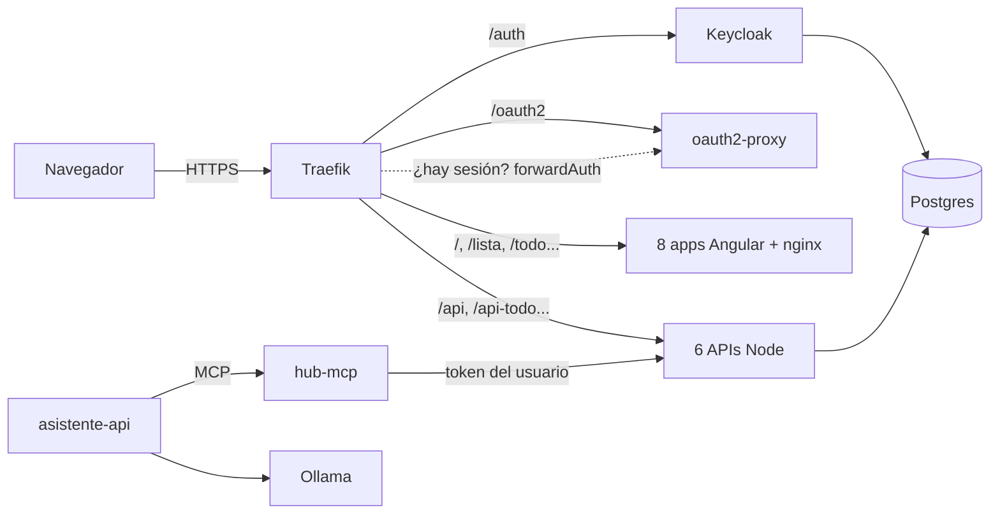

# Hub de casa

**Español** · [English](README.en.md)

Un conjunto de aplicaciones web para organizar el día a día de casa —
lista de la compra, tareas, calendario, gastos y menú semanal — pensadas
para usarse solo o en grupo (pareja, familia, compañeros de piso...). Todo
vive bajo un único dominio, con una sola cuenta de usuario, el mismo diseño
en todas las apps y un asistente al que se le pueden pedir las cosas
hablando.

Este repositorio está pensado para que **cualquiera se lo monte en su
casa**: aquí tienes el código, cómo compilar las imágenes y cómo
desplegarlo con **Docker Compose** o en **Kubernetes**, incluido el inicio
de sesión con Keycloak y el asistente con su servidor MCP.

- [Qué incluye](#qué-incluye)
- [Cómo está montado](#cómo-está-montado)
- [Compilar las imágenes](#compilar-las-imágenes)
- [Despliegue con Docker Compose](#despliegue-con-docker-compose)
- [Despliegue en Kubernetes](#despliegue-en-kubernetes)
- [Keycloak y el inicio de sesión](#keycloak-y-el-inicio-de-sesión)
- [Asistente y MCP](#asistente-y-mcp)
- [Opcionales: avisos push, Google Calendar, precios, páginas legales](#opcionales)
- [Copias de seguridad y actualizaciones](#copias-de-seguridad-y-actualizaciones)
- [Solución de problemas](#solución-de-problemas)
- [Contribuir](#contribuir)
- [Licencia](#licencia)

---

## Qué incluye

| App | Ruta | Para qué sirve |
|---|---|---|
| Inicio | `/` | Portada: resumen «Hoy» con lo importante de las demás apps y activación de avisos push |
| Lista de la compra | `/lista` | Lista colaborativa con categorías automáticas, secciones propias (tiendas, «para mamá»...), productos fijos y comparador de precios |
| Tareas | `/todo` | Tareas personales o de grupo, en lista o tablero kanban, con fecha, importancia y repetición |
| Calendario | `/calendario` | Notas y eventos por día, con hora, aviso y repetición; opcionalmente con tu Google Calendar |
| Gastos | `/gastos` | Gastos personales o compartidos, presupuesto por categoría y quién debe a quién |
| Menú | `/menu` | Comidas y cenas de la semana; manda los ingredientes a la lista de la compra |
| Perfil / Grupos | `/perfil`, `/grupos` | Tu cuenta, amistades, grupos, actividad reciente, descargar o borrar tus datos |

Todo lo personal solo lo ves tú; lo de un grupo, solo sus miembros. Las
apps son PWA: se pueden instalar en el móvil y siguen mostrando lo último
cargado sin conexión.

## Cómo está montado



| Carpeta | Qué es |
|---|---|
| `inicio`, `lista-compra`, `todo`, `calendario`, `gastos`, `menu`, `perfil`, `grupos` | Apps Angular (cada una con su `Dockerfile`: compila y sirve con nginx) |
| `lista-compra-api` | Perfil, amistades, grupos, invitaciones, listas, avisos push y comparador de precios |
| `todo-api`, `calendario-api`, `gastos-api`, `menu-api` | Una API por app (Express + Postgres + WebSocket) |
| `asistente-api` | Chat del asistente (Ollama + herramientas de hub-mcp) |
| `hub-mcp` | Servidor MCP: las apps como herramientas para un modelo |
| `deploy/` | Traefik (Compose), Keycloak (realm), Postgres (script de bases), Kubernetes (kustomize) |
| `scripts/` | `build-images.sh` y `generar-secretos.sh` |

Cómo funciona el login, en una frase: **Traefik pregunta a oauth2-proxy si
cada petición tiene sesión**; si no la tiene, oauth2-proxy te manda al
login de Keycloak; si la tiene, Traefik deja pasar la petición y le añade
tu token de Keycloak (`X-Auth-Request-Access-Token`), que cada API vuelve a
verificar por su cuenta contra las claves públicas del realm. Las APIs no
tienen usuarios ni contraseñas propias: el usuario es el `sub` del token.

Rutas públicas (sin login): `/auth` (Keycloak), `/oauth2` (el propio
login), `/legal/` y `/robots.txt`. Todo lo demás pide sesión.

## Compilar las imágenes

No hay imágenes publicadas: se compilan a partir de este repositorio. Son
15 (8 apps web + 7 servicios Node) y cada carpeta tiene su `Dockerfile`
autocontenido (las apps Angular se compilan dentro de Docker, no hace falta
tener Node instalado).

Requisitos: Docker 24+ (con BuildKit). En una Raspberry Pi 5 tarda una
media hora la primera vez; en un PC normal, bastante menos.

```bash
# Todas, como imágenes locales compra-hub/<app>:latest
sh scripts/build-images.sh

# Solo algunas
sh scripts/build-images.sh lista-compra todo-api

# Con tu registro y una etiqueta, y subiéndolas
REGISTRY=registry.tudominio.com/hub TAG=1.0.0 PUSH=1 sh scripts/build-images.sh

# Multi-arquitectura (p.ej. compilar en un PC x86 para un clúster ARM)
PLATFORMS=linux/amd64,linux/arm64 REGISTRY=registry.tudominio.com/hub TAG=1.0.0 sh scripts/build-images.sh
```

Si prefieres hacerlo a mano, es un `docker build` por carpeta:

```bash
docker build -t compra-hub/lista-compra:latest lista-compra
docker build -t compra-hub/lista-compra-api:latest lista-compra-api
# ...
```

Lista completa: `inicio lista-compra todo calendario gastos menu perfil
grupos lista-compra-api todo-api calendario-api gastos-api menu-api
asistente-api hub-mcp`.

## Despliegue con Docker Compose

Levanta todo en una sola máquina: Traefik (HTTPS con Let's Encrypt),
Postgres, Keycloak, oauth2-proxy, las 7 APIs y las 8 apps. En reposo usa
alrededor de 1 GB de RAM (Keycloak, unos 600 MB).

### 1. Requisitos

- Docker con el plugin `docker compose` y `openssl`.
- Un dominio (o subdominio) que apunte a la máquina, con los puertos 80 y
  443 abiertos hacia ella para que Let's Encrypt pueda emitir el
  certificado. Si solo quieres probarlo en local, mira el apartado
  [Probar en local](#probar-en-local-sin-dominio).

### 2. Configuración

```bash
git clone --branch 1.0.0 https://github.com/ElPostilla/compra-hub-selfhosted.git hub && cd hub
sh scripts/generar-secretos.sh     # crea .env desde .env.example y rellena contraseñas y claves
```

Abre `.env` y revisa al menos:

| Variable | Qué poner |
|---|---|
| `HUB_DOMAIN` | Tu dominio, p.ej. `casa.tudominio.com` (sin `https://`) |
| `ACME_EMAIL` | Tu email para Let's Encrypt (opcional, recomendado) |
| `VAPID_SUBJECT` | `mailto:` con tu email (lo exige el estándar de avisos push) |
| `OLLAMA_URL`, `OLLAMA_MODEL` | Dónde está tu Ollama, si quieres asistente (ver [Asistente y MCP](#asistente-y-mcp)) |

`--branch 1.0.0` fija la última versión publicada (ver
[releases](https://github.com/ElPostilla/compra-hub-selfhosted/releases) y
[CHANGELOG.md](CHANGELOG.md)); sin él tendrás `main`, que puede estar a
medias.

`generar-secretos.sh` solo rellena lo que esté vacío: se puede volver a
ejecutar sin miedo. `.env` está en `.gitignore`; no lo subas a ningún sitio.

### 3. Compilar y arrancar

```bash
sh scripts/build-images.sh
docker compose up -d
docker compose ps        # espera a que keycloak salga como "healthy" (1-2 minutos)
```

La primera vez, Postgres crea una base y un usuario por servicio
(`deploy/postgres/init-multi-db.sh`) y Keycloak importa el realm `compras`
(`deploy/keycloak/realm-compras.json`) con el dominio y el secreto del
cliente de tu `.env`.

### 4. Primer acceso

1. Abre `https://<HUB_DOMAIN>`: te llevará al login de Keycloak.
2. Pulsa **Regístrate** y crea tu cuenta. Ya estás dentro.
3. Repasa [Keycloak y el inicio de sesión](#keycloak-y-el-inicio-de-sesión)
   para activar «eliminar cuenta», decidir si dejas el registro abierto y
   configurar el correo.

La consola de administración de Keycloak está en
`https://<HUB_DOMAIN>/auth/admin/` (usuario `admin`, contraseña
`KEYCLOAK_ADMIN_PASSWORD` de tu `.env`).

### Probar en local (sin dominio)

```bash
# en .env
HUB_DOMAIN=hub.localhost
TLS_CERT_RESOLVER=
```

`*.localhost` apunta a tu propio equipo en los navegadores modernos. Con
`TLS_CERT_RESOLVER` vacío, Traefik usa un certificado autofirmado: el
navegador avisará la primera vez y tendrás que aceptarlo (también para
`/auth`). Los avisos push no funcionan con certificados autofirmados.

### Detrás de otro proxy

Si ya tienes un proxy inverso en la máquina (Nginx Proxy Manager, Caddy,
un túnel...), cambia `HTTP_PORT`/`HTTPS_PORT` en `.env`, deja
`TLS_CERT_RESOLVER` vacío y reenvía el tráfico HTTPS de tu dominio al
puerto de Traefik. Traefik tiene que seguir recibiendo el dominio original
(cabecera `Host`), porque las rutas se deciden por él.

## Despliegue en Kubernetes

Los manifiestos están en `deploy/` como un proyecto de **kustomize**
(`kubectl apply -k`), en el namespace `compra-hub`. Incluyen Postgres,
Keycloak, oauth2-proxy, las APIs, las apps y los Ingress.

### 1. Requisitos

- **Traefik** como Ingress controller (el que trae k3s por defecto): el
  login usa sus Middlewares (`forwardAuth` y `stripPrefix`). Con otro
  controller tendrías que traducir `deploy/k8s/ingress.yaml` (en
  ingress-nginx: `auth-url`, `auth-signin` y `auth-response-headers`).
- Una StorageClass por defecto para el volumen de Postgres (5 GiB).
- Opcional: **cert-manager** con un ClusterIssuer `letsencrypt-prod` para
  el certificado (si tu issuer se llama distinto, cambia la anotación en
  `deploy/k8s/ingress*.yaml`; si no usas cert-manager, quítala).

### 2. Llevar las imágenes al clúster

Compila las imágenes ([Compilar las imágenes](#compilar-las-imágenes)) y
elige una opción:

- **Con un registro** (cualquier clúster):

  ```bash
  REGISTRY=registry.tudominio.com/hub TAG=1.0.0 PUSH=1 sh scripts/build-images.sh
  cd deploy
  for app in inicio lista-compra todo calendario gastos menu perfil grupos \
             lista-compra-api todo-api calendario-api gastos-api menu-api asistente-api hub-mcp; do
    kustomize edit set image compra-hub/$app=registry.tudominio.com/hub/$app:1.0.0
  done
  cd ..
  ```

  (sin el binario `kustomize`, edita a mano el bloque `images:` de
  `deploy/kustomization.yaml`). Si el registro es privado, crea un Secret
  `docker-registry` en el namespace y añádelo como `imagePullSecrets`.

- **k3s de un solo nodo, sin registro**: importa las imágenes locales en
  containerd (los manifiestos usan `imagePullPolicy: IfNotPresent`):

  ```bash
  for app in inicio lista-compra todo calendario gastos menu perfil grupos \
             lista-compra-api todo-api calendario-api gastos-api menu-api asistente-api hub-mcp; do
    docker save compra-hub/$app:latest | sudo k3s ctr images import -
  done
  ```

### 3. Configuración

```bash
sh scripts/generar-secretos.sh k8s   # crea deploy/k8s/secrets.env (no se sube a git)
```

Edita `deploy/k8s/config.env`:

| Variable | Qué poner |
|---|---|
| `HUB_DOMAIN` | Tu dominio. kustomize lo copia a los Ingress |
| `OIDC_ISSUER` | `https://<HUB_DOMAIN>/auth/realms/compras` con el Keycloak incluido |
| `OIDC_JWKS_URI` | Déjalo como está con el Keycloak incluido (URL interna) |
| `OLLAMA_URL`, `OLLAMA_MODEL` | Tu Ollama, si quieres asistente |
| `VAPID_SUBJECT` | `mailto:` con tu email |

### 4. Desplegar

```bash
kubectl apply -k deploy/
kubectl -n compra-hub get pods -w      # Keycloak tarda 1-2 minutos en estar Ready
```

Abre `https://<HUB_DOMAIN>` y regístrate como en Docker.

Cambios de configuración: edita `config.env` o `secrets.env` y vuelve a
hacer `kubectl apply -k deploy/` (kustomize genera ConfigMaps/Secrets con
un sufijo nuevo y los pods se reinician solos).

### Si oauth2-proxy no llega a Keycloak

oauth2-proxy descubre Keycloak por la URL **pública** (`OIDC_ISSUER`). Si
desde dentro del clúster tu dominio resuelve a la IP pública del router y
el router no hace *NAT loopback*, el login fallará con errores de
*discovery* en los logs de oauth2-proxy. Solución: añade en
`deploy/k8s/oauth2-proxy.yaml` un `hostAliases` con la IP interna del
Service de Traefik (`kubectl -n kube-system get svc traefik`); el ejemplo
está comentado en el propio fichero.

## Keycloak y el inicio de sesión

### Qué se crea automáticamente

`deploy/keycloak/realm-compras.json` se importa la primera vez que arranca
Keycloak (si el realm ya existe, no se toca) y crea:

- El realm **`compras`**, en español, con registro abierto, «recordarme»,
  restablecer contraseña y protección contra fuerza bruta.
- Sesiones de 24 horas (`ssoSessionIdleTimeout`/`ssoSessionMaxLifespan`),
  igual que la cookie de oauth2-proxy (`--cookie-expire=24h`), y tokens de
  acceso de 5 minutos (oauth2-proxy los renueva cada 2, `--cookie-refresh`).
- El cliente confidencial **`compras`** (el que usa oauth2-proxy), con:
  - redirect URIs `https://<dominio>/oauth2/callback` y
    `https://<dominio>/legal/*` (la segunda la usa «eliminar mi cuenta»);
  - post logout redirect URI `https://<dominio>/*`;
  - el secreto `OAUTH2_PROXY_CLIENT_SECRET`;
  - un *audience mapper* que añade `compras` a los tokens (las APIs
    aceptan las audiencias `compras` y `account`, variable `OIDC_AUDIENCES`).

> El nombre del cliente tiene que ser `compras`: lo usan oauth2-proxy
> (`--client-id`) y la página de perfil para borrar la cuenta.

### Pasos manuales recomendados

En la consola (`https://<dominio>/auth/admin/`, realm **compras**):

1. **Permitir que cada persona borre su cuenta** desde Perfil →
   Privacidad (borra sus datos del hub y después su usuario de Keycloak):
   - *Authentication → Required actions*: activa **Delete Account**.
   - *Realm settings → User registration → Default roles*: **Assign role**
     → filtra por clientes → `account` **delete-account**.

   O desde la línea de comandos (Docker; en Kubernetes, igual con
   `kubectl -n compra-hub exec deploy/keycloak --`):

   ```bash
   docker compose exec keycloak bash -c '
     K=/opt/keycloak/bin/kcadm.sh
     $K config credentials --server http://localhost:8080/auth --realm master --user admin --password "$KC_BOOTSTRAP_ADMIN_PASSWORD"
     $K update authentication/required-actions/delete_account -r compras -s enabled=true
     $K add-roles -r compras --rname default-roles-compras --cclientid account --rolename delete-account'
   ```

2. **Correo** (*Realm settings → Email*): sin SMTP no funciona «¿Has
   olvidado tu contraseña?». Cualquier proveedor SMTP vale.
3. **¿Registro abierto o cerrado?** Si el hub está en internet y es solo
   para tu familia, desactiva *Realm settings → Login → User registration*
   y crea las cuentas tú en *Users → Add user* (pestaña *Credentials* para
   la contraseña). Con el registro abierto, cualquiera que llegue a la URL
   puede crearse una cuenta (aunque solo vea sus propios datos).
4. **Admin permanente**: el usuario `admin` del arranque es temporal según
   Keycloak. Crea un administrador definitivo en el realm `master` y borra
   el temporal.
5. Opcional: términos y condiciones al registrarse (*Required actions →
   Terms and Conditions*, «Default action» activado).

La consola de administración queda publicada en `/auth/admin`. Si quieres
limitarla a tu red, añade en Traefik un middleware `ipAllowList` para esa
ruta.

### Usar un Keycloak que ya tienes

1. Prepara el realm con tus valores (el importador de la consola no
   sustituye variables):

   ```bash
   sed -e 's/${HUB_DOMAIN}/casa.tudominio.com/g' \
       -e "s/\${OAUTH2_PROXY_CLIENT_SECRET}/$(grep ^OAUTH2_PROXY_CLIENT_SECRET= .env | cut -d= -f2)/" \
       deploy/keycloak/realm-compras.json > /tmp/realm-compras.json
   ```

   e impórtalo en *Create realm → Resource file*. Si ya tienes un realm que
   quieras reutilizar, crea solo el cliente `compras` con la configuración
   de la lista anterior.
2. Apunta el hub a tu Keycloak:
   - `OIDC_ISSUER=https://<tu-keycloak>/realms/compras` (con o sin `/auth`
     según tu instalación; tiene que coincidir con el campo `iss` de los
     tokens, lo ves en `<issuer>/.well-known/openid-configuration`).
   - `OIDC_JWKS_URI`: la URL interna de las claves si la tienes, o bórrala.
   - oauth2-proxy: `--oidc-issuer-url` igual que `OIDC_ISSUER`, y añade
     `--whitelist-domain=<dominio de tu keycloak>` (el cierre de sesión
     redirige a Keycloak y oauth2-proxy solo redirige a dominios permitidos).
3. **Docker Compose**: borra los servicios `keycloak` (y su
   `depends_on` en oauth2-proxy), la variable `KEYCLOAK_DB_PASSWORD` y, en
   `deploy/traefik/dynamic.yml`, el router `keycloak`. Cambia `OIDC_ISSUER`
   y `OIDC_JWKS_URI` en el bloque `x-auth-env` de `docker-compose.yml`.
   **Kubernetes**: quita `k8s/keycloak.yaml` y `k8s/ingress-keycloak.yaml`
   de `deploy/kustomization.yaml` y cambia `config.env`.

## Asistente y MCP

El hub trae un asistente (botón de chat en todas las apps) que entiende
cosas como «añade leche y huevos a la lista», «recuérdame pagar la luz el
viernes» o «¿qué cenamos hoy?». Está formado por dos piezas:

- **`hub-mcp`**: un servidor [MCP](https://modelcontextprotocol.io) que
  expone las apps como herramientas (`compra_anadir`, `tareas_crear`,
  `menu_planificar`, `receta_anadir`... lista completa en
  [`hub-mcp/README.md`](hub-mcp/README.md)). Actúa **siempre con el token
  del usuario que habla**: las APIs aplican sus permisos normales y los
  cambios se ven al momento en las apps de los demás miembros del grupo.
- **`asistente-api`**: el chat. Manda la conversación a un modelo de
  [Ollama](https://ollama.com) junto con las herramientas de `hub-mcp`,
  ejecuta las que el modelo pide y devuelve la respuesta en streaming.

### Conectar el asistente a un modelo

Necesitas un Ollama con un modelo que sepa usar herramientas. El prompt y
las pruebas están hechos con **`gemma4:e4b`** (unos 10 GB); otros modelos
con *tool calling* funcionan, con más o menos acierto.

- **Ollama en otra máquina** (lo habitual, un PC con GPU): en esa máquina
  `ollama pull gemma4:e4b` y arranca Ollama escuchando en la red
  (`OLLAMA_HOST=0.0.0.0`). En el hub: `OLLAMA_URL=http://<ip-del-pc>:11434`
  (`.env` o `deploy/k8s/config.env`).
- **Ollama en la misma máquina, con Docker Compose**:

  ```bash
  docker compose --profile ollama up -d
  docker compose exec ollama ollama pull gemma4:e4b
  ```

  (con `OLLAMA_URL=http://ollama:11434`, el valor por defecto). Sin GPU
  funciona, pero lento.

Si Ollama no responde, el asistente aparece como «no disponible» y el resto
del hub sigue igual. El mismo modelo lo usa el comparador de precios para
elegir el producto de cada tienda (sin él, usa una regla sencilla).

**El prompt** está en `asistente-api/config/system-prompt.txt` (las líneas
con `#` son comentarios). En Docker Compose está montado en el contenedor:
edítalo y se aplica en el siguiente mensaje, sin reiniciar. En Kubernetes va
dentro de la imagen; para cambiarlo sin recompilar crea un ConfigMap y
móntalo en `/app/config`:

```bash
kubectl -n compra-hub create configmap asistente-prompt \
  --from-file=asistente-api/config/system-prompt.txt --dry-run=client -o yaml | kubectl apply -f -
# y en deploy/k8s/apis.yaml, Deployment asistente-api: un volumen con ese
# ConfigMap montado en /app/config
```

### Añadir el MCP del hub a otros clientes (Open WebUI, etc.)

`hub-mcp` también se puede usar desde cualquier cliente MCP que hable
**Streamable HTTP** y mande en cada petición
`Authorization: Bearer <access token del realm compras>`. El token tiene
que llevar la audiencia `compras`. Sin token responde con una redirección
al login.

**Dirección del servidor**:

| Desde dónde | URL |
|---|---|
| Otro contenedor de la misma red de Compose | `http://hub-mcp:3000/mcp` |
| Dentro de Kubernetes | `http://hub-mcp.compra-hub.svc.cluster.local:3000/mcp` |
| Desde fuera | `https://<HUB_DOMAIN>/mcp`, activándolo: `HUB_MCP_PUBLIC=true` en `.env` (Compose) o descomentando `k8s/ingress-mcp.yaml` en `deploy/kustomization.yaml` |

**Ejemplo con Open WebUI** (las personas inician sesión en Open WebUI con
su cuenta del hub y el asistente de Open WebUI actúa en su nombre):

1. En Keycloak, realm `compras` → *Clients → Create client*:
   - Client ID `open-webui`, *Client authentication* activado.
   - Valid redirect URIs: `https://<tu-open-webui>/oauth/oidc/callback`.
   - En *Client scopes → open-webui-dedicated → Add mapper → By
     configuration → Audience*: *Included Client Audience* = `compras`,
     *Add to access token* activado.
   - Copia el secreto de la pestaña *Credentials*.
2. En Open WebUI, variables de entorno:

   ```env
   ENABLE_OAUTH_SIGNUP=true
   OAUTH_PROVIDER_NAME=Hub de casa
   OPENID_PROVIDER_URL=https://<HUB_DOMAIN>/auth/realms/compras/.well-known/openid-configuration
   OAUTH_CLIENT_ID=open-webui
   OAUTH_CLIENT_SECRET=<secreto del paso 1>
   OAUTH_SCOPES=openid email profile
   ```

3. En Open WebUI, *Panel de administración → Ajustes → Herramientas →
   Añadir conexión*: tipo **MCP (Streamable HTTP)**, la URL de la tabla de
   arriba y autenticación **OAuth** (*system_oauth*: reenvía el token de
   Keycloak de quien chatea y lo renueva solo). Con cuentas locales de Open
   WebUI no funciona: no hay token de Keycloak que reenviar.
4. Activa la herramienta en el modelo que quieras usar.

Para otros clientes vale el mismo esquema: un cliente de Keycloak con el
*audience mapper* `compras` y el cliente MCP configurado para mandar el
*access token* como Bearer.

## Opcionales

### Avisos push

`generar-secretos.sh` crea un par de claves VAPID (`VAPID_PUBLIC_KEY`,
`VAPID_PRIVATE_KEY`). Con ellas, en Inicio aparece «Activar avisos en este
dispositivo»: actividad de los grupos, recordatorios del calendario y
resumen mensual de gastos. Sin claves, todo funciona menos los avisos.
Necesitan HTTPS con un certificado válido. Genera un par propio por
instalación y no lo cambies después (las suscripciones dejarían de valer).

### Google Calendar

Para ver los eventos de tu Google Calendar en el calendario del hub (solo
lectura) y recibir un aviso 30 minutos antes:

1. En [Google Cloud Console](https://console.cloud.google.com/): crea un
   proyecto, habilita **Google Calendar API**, configura la pantalla de
   consentimiento (con tu cuenta como usuario de prueba si no la publicas)
   y crea credenciales **OAuth → Aplicación web** con el URI de
   redirección `https://<HUB_DOMAIN>/api-calendario/auth/callback`.
2. Pon `GOOGLE_CLIENT_ID` y `GOOGLE_CLIENT_SECRET` en `.env` (Compose) o
   `deploy/k8s/secrets.env` (Kubernetes) y vuelve a desplegar.

### Comparador de precios

Busca cada producto en las tiendas online de Mercadona y Dia (buscadores
públicos de sus webs; si cambian, habrá que ajustar
`lista-compra-api/prices.js`). Los precios de Mercadona dependen de la
zona: averigua el almacén de tu código postal con

```bash
curl -s -X PUT https://tienda.mercadona.es/api/postal-codes/actions/change-pc/ \
  -H 'content-type: application/json' -d '{"new_postal_code":"28001"}' -D - -o /dev/null | grep -i x-customer-wh
```

y ponlo en `MERCADONA_WAREHOUSE`.

### Páginas legales

`inicio/public/legal/` tiene plantillas de privacidad, cookies, condiciones
y aviso legal enlazadas desde el pie de Inicio. **Rellena los
`[CORCHETES]` y revísalas** antes de abrir el hub a otras personas; no son
asesoramiento legal. En Docker Compose están montadas en el contenedor (se
aplican al guardar); en Kubernetes van en la imagen de `inicio`
(recompílala tras editarlas).

## Copias de seguridad y actualizaciones

Todo el estado está en Postgres (datos del hub y de Keycloak).

```bash
# Docker Compose
docker compose exec -T postgres pg_dumpall -U postgres | gzip > hub-$(date +%F).sql.gz
# Restaurar en una instalación nueva (volumen vacío, antes de arrancar el resto):
#   docker compose up -d postgres && gunzip -c hub-AAAA-MM-DD.sql.gz | docker compose exec -T postgres psql -U postgres

# Kubernetes
kubectl -n compra-hub exec deploy/postgres -- pg_dumpall -U postgres | gzip > hub-$(date +%F).sql.gz
```

Programa la copia (cron, un CronJob...) y guárdala fuera de la máquina.

**Actualizar**: `git pull`, vuelve a compilar las imágenes y

```bash
docker compose up -d                  # Compose
kubectl apply -k deploy/ && kubectl -n compra-hub rollout restart deploy   # Kubernetes con la misma etiqueta
```

Las APIs crean y migran sus tablas solas al arrancar.

## Solución de problemas

| Síntoma | Causa probable |
|---|---|
| 500 o bucle de redirecciones al entrar | oauth2-proxy no llega a Keycloak: `docker compose logs oauth2-proxy` (en Kubernetes, ver [Si oauth2-proxy no llega a Keycloak](#si-oauth2-proxy-no-llega-a-keycloak)) |
| `Invalid parameter: redirect_uri` en Keycloak | El dominio del cliente `compras` no coincide con `HUB_DOMAIN` (el realm se importó con otro dominio: corrígelo en *Clients → compras*) |
| Las apps cargan pero todo da «Sesión inválida» (401) | `OIDC_ISSUER` no coincide con el `iss` de los tokens, o la API no llega a `OIDC_JWKS_URI` (`docker compose logs lista-compra-api`) |
| «Todavía no tienes listas personales» en el asistente | Un usuario nuevo tiene que abrir la app de la compra una vez para que se cree «Mi lista» |
| Asistente «no disponible» | La API no llega a `OLLAMA_URL` o el modelo no está descargado (`ollama list`) |
| No aparece «Activar avisos» | Faltan las claves VAPID o el certificado no es válido |
| Cambiaste contraseñas en `.env` y Postgres no arranca bien | Las bases solo se crean con el volumen vacío: cambia la contraseña también dentro (`ALTER USER ... PASSWORD ...`) |

## Contribuir

Las contribuciones son bienvenidas por pull request: lee
[CONTRIBUTING.md](CONTRIBUTING.md) antes (incluye la cesión de derechos
de las contribuciones). Los fallos de seguridad se reportan en privado
([SECURITY.md](SECURITY.md)). El proyecto lo mantiene y decide
[@ElPostilla](https://github.com/ElPostilla).

## Licencia

[PolyForm Noncommercial 1.0.0](LICENSE). En resumen: puedes usarlo,
copiarlo, **modificarlo** y compartir tus cambios para cualquier fin **no
comercial** (uso personal, familiar, educativo, organizaciones sin ánimo de
lucro...). **No** puedes venderlo, ofrecerlo como servicio de pago ni usarlo
con fines comerciales. Al compartirlo o compartir una versión modificada,
incluye el fichero `LICENSE` y la línea `Required Notice` que aparece al
principio. El texto que vale es el de la licencia; este resumen es solo
orientativo.

Las dependencias de terceros (Angular, Express, Keycloak, Traefik, la
tipografía Recursive...) mantienen sus propias licencias.
